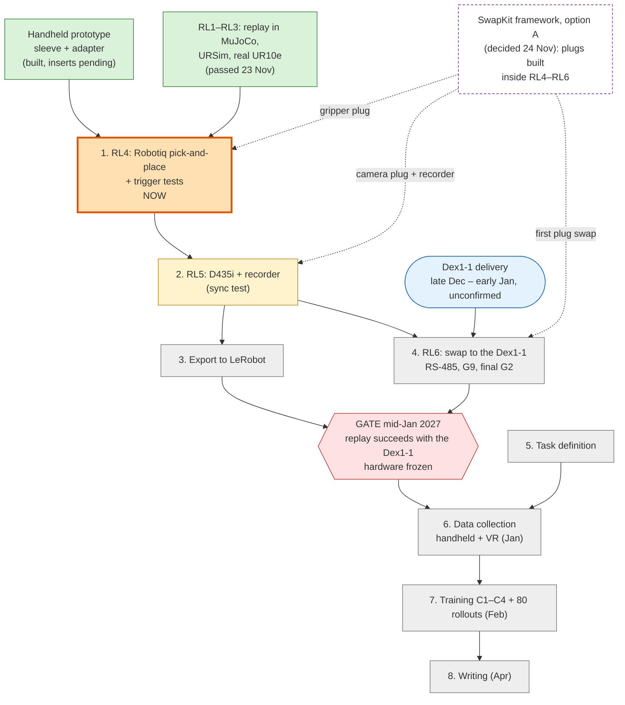

# Red Line roadmap

One path through the thesis: what comes first, what it unlocks, and where every open item belongs. Built from `msc-thesis/docs/thesis-plan.md` (§2 scope, §5 schedule and gates, §8 open items), [[Waiting]] and the Replay Ladder ([[2026-11-20 Interim hardware while the Dex1-1 is delayed]]), after the clean-up [[2026-11-24 Open items clean-up]].

**Now:** step 1, RL4 (Robotiq pick-and-place). **Next:** step 2, RL5 (D435i + recorder). Everything else waits in [[Waiting]] under its step.

## Priority tags

| Tag | Meaning |
| --- | --- |
| 🔴 **blocks next step** | The current step cannot finish without it. Do these first. |
| 🟠 **important** | Needed later, but has lead time or feeds a decision; start when there is a gap. |
| ⚪ **can wait** | Not needed before a later step, or optional. Leave it. |

Tags are relative to the step the item sits in. When a step becomes current, its 🟠 items are re-checked.

## The path

Gate and dates: `msc-thesis/docs/thesis-plan.md` §5. Task definition (step 5) runs in parallel; it must be done before data collection.

## Steps

### Done: handheld prototype and RL1–RL3 (replay in MuJoCo, URSim, real UR10e)
- Prototype: plate 4 v23 front + plate 1 v22 back sleeve, real-adapter v14, clamp-ring joint screwed (24 Nov) ([[D10 Handheld mechanism]]).
- RL1–RL3 passed 23 Nov: real UR10e within 1.0 mm RMS of the MuJoCo prediction ([[2026-11-23 RL3 real UR10e replay procedure]]).

### 1. RL4: Robotiq pick-and-place — NOW
**Needs first:** RL3 passed ✓. **Unlocks:** RL5 (a working gripper command in the replay), the first real-gripper trigger data. **Status:** not started.

| Item | Tag | Where |
| --- | --- | --- |
| RL4 procedure: find the Robotiq driver in the team repo, write the steps (written 2026-11-24: [[2026-11-24 RL4 Robotiq pick-and-place procedure]]; choices wait for Martyn) | 🔴 blocks next step | Daily TODO |
| Gripper program, Robotiq plug (one shared trigger program + a plug per gripper; team driver = open/close); this is the SwapKit gripper plug, option A of [[D07 Software and data format]] | 🔴 blocks next step | Daily TODO (RL4) |
| D09 (calibration) fingertip offset for the replay | 🔴 blocks next step | Daily TODO (RL4) |
| G2 (trigger-to-gripper mapping), stage 1: binary on the Robotiq | 🔴 blocks next step | Daily TODO |
| G1 (trigger value vs travel) run | 🟠 important (feeds G2) | Daily TODO |
| G8 (does pressing move the controller) press test | 🟠 important (decides the start/stop button for RL5 recording) | Daily TODO |
| M3 inserts and the screwed sleeve-boss joint (prototype holds up in longer runs) | 🟠 important | [[Waiting]], Purchases |

### 2. RL5: D435i + recorder
**Needs first:** RL4. **Unlocks:** raw MCAP recordings with images; the sync test; export (step 3). **Status:** findings note ready ([[2026-11-23 RL5 sync test findings]]).

| Item | Tag | Where |
| --- | --- | --- |
| Camera CAM1 (plug in and check), CAM2 (test frames), CAM3 (recorder venv, needs Martyn's go); the only D435i is on the robot flange | 🔴 blocks next step | [[Waiting]], RL5 |
| Sync test: camera delay, pose delay, clock | 🔴 blocks next step | [[2026-11-23 RL5 sync test findings]] |
| SwapKit camera plug (D435i) and the recorder behind fixed interfaces, so the Dex1-1 camera is a plug swap later | 🔴 blocks next step | [[2026-11-24 SwapKit modular framework options]] |
| Jetson disk and the unused 256 GB SD card (ask the supervisor first) | ⚪ can wait (until recordings grow) | [[Waiting]], RL5 |
| Replay from the station Jetson instead of fractal-pc (`ur_rtde` source build) | ⚪ can wait | Daily TODO (RL4 item, "Later") |

### 3. Export to LeRobot
**Needs first:** RL5 recordings. **Unlocks:** pilot training. **Status:** format decided in D07 (software and data format): raw MCAP, offline alignment, LeRobot export.

| Item | Tag | Where |
| --- | --- | --- |
| LeRobot version (v2.1 for both models, or two outputs) | 🟠 important (before pilot training) | [[Waiting]], Export |
| Video compression loss in the export | ⚪ can wait | [[Waiting]], Export |

### 4. Dex1-1 delivery and RL6 (swap to the Dex1-1)
**Needs first:** the gripper (late Dec – early Jan, unconfirmed); RL5 for recording with it. **Unlocks:** the mid-January gate. **Status:** waiting on delivery. Fallback if the RS-485 check fails by mid-Jan: Robotiq as main gripper (last resort) or the printed copy ([[D01 Handheld gripper body]]).

| Item | Tag | Where |
| --- | --- | --- |
| RS-485 check (rate, supply, cable, mass); station 24 V supply load and voltage | 🔴 blocks next step | [[Waiting]], Dex1-1 delivery |
| RS-485-to-USB adapter (box first, else Storefront) | 🔴 blocks next step | [[Waiting]], Purchases |
| Delivery check list (stroke, version, back-drive, latency, mass, power, motor IDs) | 🔴 blocks next step | [[Waiting]], Dex1-1 delivery |
| G9 (force limit on contact): gauge tests, choose the limit | 🔴 blocks next step | [[Waiting]], Dex1-1 delivery |
| G2 stage 2: proportional vs binary, final choice | 🔴 blocks next step | Daily TODO (G2) |
| Gripper program, Dex1-1 plug: against a mock just before delivery, then real; RL6 is the first real SwapKit plug swap (Robotiq to Dex1-1) | 🟠 important | [[Waiting]], Dex1-1 delivery |
| Real-adapter checks, bow flex check (decides adapter material, before the freeze) | 🟠 important | [[Waiting]], Dex1-1 delivery |
| Cable clip; 3–5 m cable and balancer | 🟠 important | [[Waiting]] |
| Scale: weigh controller, prints, gripper | ⚪ can wait | [[Waiting]], Purchases |

### Gate (mid-January 2027)
Replayed demonstrations succeed on the robot with the Dex1-1; hardware frozen. If not met, all stretch goals are dropped (`msc-thesis/docs/thesis-plan.md` §5).

### 5. Task definition (parallel)
**Needs first:** Martyn describes the task. **Unlocks:** data collection (objects, tolerance, start-position grid). **Status:** earlier definition wrong (19 Nov), not restarted.

| Item | Tag | Where |
| --- | --- | --- |
| Task definition from scratch | 🟠 important (no hardware needed; good gap filler) | Daily TODO |

### 6. Data collection (January)
**Needs first:** gate passed, task defined, rejection rules written. **Unlocks:** training.

| Item | Tag | Where |
| --- | --- | --- |
| Rejection rules (decide after the Replay Ladder; evidence log running) | ⚪ can wait (until RL6 is done) | [[Waiting]], Later stages; [[2026-11-24 Demo rejection rules evidence log]] |
| Confirm with the team: teleop data format, policy family, camera views | 🟠 important | `msc-thesis/docs/thesis-plan.md` §8 |
| 20 rollouts per condition underpowered: keep or change | ⚪ can wait | [[Waiting]], Later stages |

### 7. Training and evaluation (February)
**Needs first:** data, export, a GPU with ≥ 24 GB. **Unlocks:** results table.

| Item | Tag | Where |
| --- | --- | --- |
| Larger team PC for fine-tuning (fractal-pc has 12 GB) | 🟠 important (lead time; Martyn asks) | Daily TODO |

### 8. Writing (alongside; final in April)

| Item | Tag | Where |
| --- | --- | --- |
| Related-work outline | ⚪ can wait | `msc-thesis/docs/thesis-plan.md` §8 |
| [S] items check in the PDFs before citing | ⚪ can wait | [[Waiting]], Writing |
| Zotero additions (ACT, robomimic, Diffusion Policy, Open X-Embodiment, LeRobot) | ⚪ can wait | [[Waiting]], Writing |

## Off the path (no step depends on these)

| Item | When it becomes active | Where |
| --- | --- | --- |
| SwapKit portability test (option C: same episode on two grippers, measured) and H2 plug | March buffer, only if the gate is met; H2 stays stretch (thesis plan §2) | [[2026-11-24 SwapKit modular framework options]], [[D07 Software and data format]] |
| Printed-copy fallback | RS-485 check fails or delivery slips | [[Waiting]], Printed-copy fallback |
| Grip sleeve closure survey | Sleeve stops snapping or slips | [[Waiting]], Later stages |
| Rough support faces under the clamp collar; ufw rule on fractal-pc | Next reprint / ever | [[Waiting]], Later stages |
| PICO Motion Trackers; H2 (humanoid) deployment; bimanual | Only if time allows (stretch, thesis plan §2) | [[Waiting]], Only if time allows |
| Handover clean-up of `dex1-1-handheld` | Thesis end | [[Waiting]], Thesis end; [[Handover]] |

## Rules

- A new item gets a home here (step + tag) before anyone works on it. If it belongs to a later step, it goes to [[Waiting]] under that step and work stays on the current step.
- Daily TODO holds at most 3 tasks, taken from the current step, 🔴 first.
- A step is done when all its 🔴 items are done; then its 🟠 items are re-checked and the next step becomes "Now".
