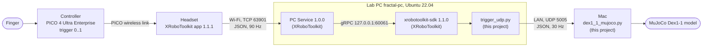

# PICO trigger test: knowledge base

Reference for everything known about driving a simulated Dex1-1 from the PICO 4 Ultra Enterprise controller trigger through XRoboToolkit. It holds how the chain works, what was measured, what was read in source code, what was decided, and what is still unknown. The visual version is the page [Trigger to Gripper](https://claude.ai/artifact/Axkm9SVvxYQtvcriaF56MB) (private Artifact). Research gaps derived from the test: [[2026-11-10 Research gaps from the PICO sim test]].

**How to keep it current:** add a row to the test log (section 4) after each new test and a row to the facts register (section 5) for each new fact. Do not delete old rows. When a fact is replaced, mark the old row *superseded by F-nn*. Every row needs a status: **Measured** (run on the hardware), **Source** (read in public code), **Paper** (published), or **Unverified**.

**Basis of this version:** the 2026-11-09 run (`msc-thesis` PR #16, [[2026-11-09]]) and a source review on 2026-11-10. Nothing was re-run on 2026-11-10.

## 1. Summary

- The right trigger of the PICO controller drives the simulated Dex1-1 fingers in MuJoCo, end to end, in real time (2026-11-09).
- The signal passes four devices: controller, headset, lab PC, Mac. The lab PC is needed because XRoboToolkit's PC Service and SDK have no macOS build.
- Measured: 425 UDP messages in about 14 s, 0 lost. The pad gap of the model is 80.0 / 39.0 / −2.0 mm at trigger 0 / 0.5 / 1.
- Read in source: the ports, the meaning of the timestamp (headset clock at packing time) and the 90 Hz source rate. Unitree's own Dex1-1 teleop maps the trigger differently from the linear mapping used here.
- Not known yet: trigger resolution and dead zone, squeeze-to-motion latency, clock offset between headset and PC, link reliability over a full session, and the real finger stroke.

## 2. How the chain works



### Components: where each lives and who wrote it

| Component | What it does (plain) | Runs on | Code of | Where the code is |
| --- | --- | --- | --- | --- |
| XRoboToolkit app 1.1.1 | Reads the controller and sends its data | Headset | XRoboToolkit | Public repo [XRoboToolkit-Unity-Client](https://github.com/XR-Robotics/XRoboToolkit-Unity-Client). Its `Assets/` folder holds the app's own code. It is not in `msc-thesis` and not on the lab PC; it was read online only. |
| PC Service 1.0.0 (`RoboticsServiceProcess`) | Background program ("service") that receives the headset stream and keeps the newest value of each control | Lab PC | XRoboToolkit | Public repo [XRoboToolkit-PC-Service](https://github.com/XR-Robotics/XRoboToolkit-PC-Service). Installed from a `.deb` (installer package) into `/opt/apps/roboticsservice/`. |
| `xrobotoolkit-sdk` 1.1.0 | Python add-on that reads values from the PC Service. Built with Pybind, a glue tool that exposes C++ code to Python | Lab PC, conda env `xrobotoolkit` | XRoboToolkit | Public repo [XRoboToolkit-PC-Service-Pybind](https://github.com/XR-Robotics/XRoboToolkit-PC-Service-Pybind) |
| `trigger_udp.py` | Polls the trigger 30 times per second and sends each value to the Mac | Lab PC | This project | `msc-thesis/software/xr/` on the Mac is the master. It was copied once with `scp` (copy over a secure connection) to `~/xr_trigger/` on the lab PC. The lab PC has no clone of the repo, so Git never updates that copy. Edit on the Mac, then copy again. |
| `dex1_1_mujoco.py`, `run_dex1_1.sh` | Builds the Dex1-1 model, receives the UDP messages, moves the fingers | Mac, conda env `mujoco-lab` | This project | `msc-thesis/software/sim/` |
| Setup guide | Install, per-session steps, troubleshooting | none | This project | `msc-thesis/docs/setup/pico-trigger-sim.md` |

To check that the two copies of `trigger_udp.py` are identical (equal checksums mean equal files):
```
shasum -a 256 ~/msc-thesis/software/xr/trigger_udp.py; ssh fractal-pc sha256sum ~/xr_trigger/trigger_udp.py
```
Whether they match today is unverified.

### The hops

| Hop | Transport | Rate | Detail |
| --- | --- | --- | --- |
| Controller → headset | PICO wireless link | not documented | |
| Headset → PC Service | TCP 63901 over Wi-Fi | 90 Hz, one JSON object | TCP acknowledges data and resends lost data. A *port* is a numbered entry point of a computer; the lab PC's firewall (`ufw`) has to allow it. Needs "Tracking → Controller" and "Data & Control → Send" switched on in the headset app, otherwise the trigger stays 0. |
| PC Service → SDK | gRPC on 127.0.0.1:60061 | on demand | gRPC is a call between two programs; here both run on the lab PC, so it never leaves the machine. The service keeps each value behind a *mutex* (a lock so a value is never read half-written). |
| `trigger_udp.py` → Mac | UDP 5005 over the LAN | 30 Hz | UDP does not resend; a lost value is replaced by the next one 33 ms later. Message: `{"seq", "trigger", "xr_ts_ns", "send_ts_ns"}`. |
| Mac model | MuJoCo | | Finger target = 0.041 m × (1 − trigger) per finger. Holds the last value if messages stop. |

**Why the lab PC is in the middle:** PC Service and SDK exist for Windows and Linux only (XRoboToolkit READMEs). The Linux PC terminates the headset stream; the Mac only runs the model.

## 3. How the model was built

- Geometry: Unitree's official Dex1-1 URDF 261030 (not in Git, see `msc-thesis/hardware/dex1-1-reference/README.md`), loaded at run time.
- One finger is driven; the other follows through an equality constraint. This is the rule given in XRoboToolkit's `teleop_details.md` for parallel grippers.
- The actuator is a position servo on the trigger value (0 open, 1 closed), stiffness 2000 N/m, joint damping 2 N s/m, armature 0.01. These are chosen values, not Dex1-1 data.
- Collisions and gravity are off: the finger meshes include the racks, which cross the centre line and would jam. The model therefore shows motion only, no grasping.
- Check without viewer: `bash software/sim/run_dex1_1.sh --check`.

## 4. Test log

| Date | Test | Setup | Result | Notes |
| --- | --- | --- | --- | --- |
| 2026-11-09 | PICO right trigger → MuJoCo Dex1-1, end to end | Headset (XRoboToolkit 1.1.1) → fractal-pc (PC Service 1.0.0, SDK 1.1.0, `trigger_udp.py`) → Mac (`dex1_1_mujoco.py --udp 5005`) | Fingers followed the trigger. 425 messages in about 14 s (30 per s), 0 lost. | Headset stayed "connecting" until ufw allowed TCP 63901. Trigger read 0.000 until "Tracking → Controller" and "Send" were on. |
| 2026-11-09 | Port measurement with `ss` while streaming | fractal-pc | TCP 63901: about 63 kB/s in from the headset. TCP 60061 (localhost): about 67 kB/s out to the SDK. UDP 42952: 0 bytes received, 1920 bytes stuck in the send queue. | Each headset reconnect left the old TCP connection open (two idle ones seen). |
| 2026-11-09 | Model travel check (`--check`) | Mac | Pad gap 80.0 / 39.0 / −2.0 mm at trigger 0 / 0.5 / 1 | The URDF pads overlap 2 mm when closed. |
| 2026-11-10 | Source review (no run) | Public code at pinned commits | Facts F-04 to F-12 below | Commits: PC Service `85bac4d`, Pybind `8941e1d`, Unity client `cdc5316`, teleop sample `79e5cb8`, Unitree xr_teleoperate `817fb00`, televuer `766de45` |

## 5. Facts register

| ID | Fact | Status | Source / evidence | Date |
| --- | --- | --- | --- | --- |
| F-01 | Chain works end to end; 0 of 425 messages lost in about 14 s | Measured | Test log row 1 | 2026-11-09 |
| F-02 | Model pad gap 80.0 / 39.0 / −2.0 mm at trigger 0 / 0.5 / 1; 0.041 m travel per finger | Measured | `--check`, URDF 261030 | 2026-11-09 |
| F-03 | Headset sends about 63 kB/s to TCP 63901; PC Service to SDK about 67 kB/s on 60061 | Measured | `ss` on fractal-pc | 2026-11-09 |
| F-04 | The trigger is a float read from Unity (`CommonUsages.trigger`) and sent as `"trigger"` in the JSON | Source | Unity client `Assets/Scripts/TrackingData.cs`, `GetControllerJsonData` | 2026-11-10 |
| F-05 | Trigger range is 0 to 1; all tracking data in one JSON object at 90 Hz | Paper | zhao2025, section II-B | 2026-11-10 |
| F-06 | Headset connects to TCP 63901; PC Service listens on all addresses | Source | `TcpHandler.cs` (`TCP_PORT = 63901`); `Manage_global.h` (`DEFAULT_TCP_PORT`); `tcpserverworker.cpp` | 2026-11-10 |
| F-07 | PC Service gRPC listens on 127.0.0.1:60061 by default | Source | `PXREAGRPCServer.cpp` (`setting.ini` keys `Service/listenAddr`, `Service/listenPort`) | 2026-11-10 |
| F-08 | UDP 42952 is probably the sending port of the PC Service's discovery broadcast (own IP to `<subnet>.255:29888` every 5 s). Its ufw rule is probably unnecessary. | Unverified (inferred from F-08 code, not tested) | `tcpserverworker.cpp` (`onBraodCastTCPServer`, 5000 ms); `UIUdpReceiver.cs` (`UdpListenPort = 29888`) | 2026-11-10 |
| F-09 | `timeStampNs` is the headset's UTC clock when the JSON is packed, not the sensor sample time. Its offset to the PC clock is unmeasured. | Source | `TrackingData.cs`, `Utils.cs` (`DateTime.UtcNow`); sensor-time line is commented out | 2026-11-10 |
| F-10 | The SDK returns only the newest value per field, each behind its own mutex. Trigger and timestamp are separate calls, so a pair can come from two messages. | Source | Pybind `bindings/py_bindings.cpp` | 2026-11-10 |
| F-11 | No macOS build of PC Service or SDK | Source | PC Service README (Windows, Linux x86, Linux aarch64); Pybind README and `CLAUDE.md` | 2026-11-10 |
| F-12 | Two trigger-to-gripper mappings exist. XRoboToolkit sample: linear over 0 to 1 (`calc_parallel_gripper_position`). Unitree controller mode: `10 − 10t`, interpolated over [5, 7] to [0, 5.4] rad, so open below about 0.3, closed above about 0.5, with ±0.18 rad per step at 200 Hz. | Source (Unitree part inferred from code, not run) | Teleop sample `utils/parallel_gripper_utils.py`; `televuer` `tv_wrapper.py`; `xr_teleoperate` `robot_hand_unitree.py` | 2026-11-10 |
| F-13 | Only video latency is published for XRoboToolkit (82 to 100.5 ms). No trigger or pose latency. | Paper | zhao2025, section IV-A, Table II | 2026-11-10 |
| F-14 | The trigger's resolution, dead zone and linearity are not documented | Unverified | zhao2025 II-B gives only "between 0 and 1" | 2026-11-10 |
| F-15 | Finger stroke: official URDF about 82 to 83 mm, product page 90 mm | Unverified | To be measured on the real gripper | 2026-11-03 |

## 6. Decisions of 2026-11-09 and their basis

| Decision | Reason | Backed by |
| --- | --- | --- |
| Use the Linux PC as the middle station | No macOS build (F-11) | Source |
| SDK in its own conda env, version pinned to 1.1.0 | Isolation, repeatability | PyPI version equals Pybind `pyproject.toml` 1.1.0 |
| Check the `.deb` SHA-256 | Genuine release | Checksum matched the release |
| ufw: TCP 63901 from 10.36.0.0/16 | Headset stayed "connecting" | F-06. The subnet mask is unchecked. |
| ufw: UDP 42952 | Added while troubleshooting | Probably unnecessary (F-08) |
| Start the PC Service by hand per session, stop it at the end | It does not autostart; reconnects left stale TCP connections | README gives the start command (`runService.sh`) and no autostart; the stale connections were seen, not explained |
| UDP + JSON, port 5005, 30 Hz | Simple; 30 Hz is the training export rate | Own choice |
| Hold the last value if messages stop | The model must not jump | Own choice. Fine for the model; undecided for the real gripper. |
| Linear trigger mapping over the full range | Simplest, same as XRoboToolkit's sample | F-12. Not yet compared with Unitree's band. |
| Collisions off | Finger meshes overlap | Stated in the code |

## 7. Review notes on the code

- `trigger_udp.py`: correct for its purpose. `xrt.close()` maps to the SDK's `PXREADeinit`. `send_ts_ns` uses the lab PC clock and the Mac does not log receive times, so no latency can be computed from the packets yet.
- `dex1_1_mujoco.py`: accepts messages from any host on the LAN without checking the sender (harmless in a model, worth remembering before the same pattern drives the real gripper). The lost-message counter ignores out-of-order messages and a sender restart.
- `pico-trigger-sim.md` is correct except two sentences: "the ports are not documented by XRoboToolkit" should read "not in the docs, but set in the source" (F-06, F-07), and the UDP 42952 guess can cite F-08. The guide was not changed.

## 8. Not known yet

| Question | How to answer it | Related |
| --- | --- | --- |
| Trigger resolution, dead zone, linearity (F-14) | Slow 20 s squeeze with the sender logging every value; count distinct values. Already a TODO ("trigger value vs travel"). | G1 |
| Squeeze-to-gripper latency (F-13) | Measure along the whole chain | G3 |
| Clock offset and drift, headset against PC (F-09) | Log headset and PC receive times over a session | B7, G4 |
| Link reliability over 1 to 2 h; timeout behaviour of the real gripper | Log timestamp gaps; define a timeout and an episode-rejection rule | G6 |
| Which trigger mapping the real gripper and the VR baseline use (F-12) | Decide once for both conditions; ask the intern about the VR stack | G2 |
| Real finger stroke (F-15) | Measure on the delivered gripper | |
| Lab network mask (for the ufw rule and F-08) | `ip -4 addr show enp3s0` on fractal-pc | |

Optional cleanup: remove the UDP 42952 ufw rule (`sudo ufw delete allow from 10.36.0.0/16 to any port 42952 proto udp`) and re-check that the headset still connects.

## 9. Sources

- [XRoboToolkit paper (zhao2025)](https://arxiv.org/html/2508.00097), section II-B (data rate, trigger range), IV-A (latency)
- [XRoboToolkit-PC-Service](https://github.com/XR-Robotics/XRoboToolkit-PC-Service/tree/85bac4dbc1fd5cef42c74a160d9c30aa3491f122) `85bac4d`
- [XRoboToolkit-PC-Service-Pybind](https://github.com/XR-Robotics/XRoboToolkit-PC-Service-Pybind/tree/8941e1dbbf4313fe83846f82984eaa8c992690bf) `8941e1d` (= SDK 1.1.0)
- [XRoboToolkit-Unity-Client](https://github.com/XR-Robotics/XRoboToolkit-Unity-Client/tree/cdc53166b0bf412efae71046c6a225eb5091605f) `cdc5316`
- [XRoboToolkit-Teleop-Sample-Python](https://github.com/XR-Robotics/XRoboToolkit-Teleop-Sample-Python/tree/79e5cb8a56e3455515ce1b476e993c764ec58739) `79e5cb8`
- [Unitree xr_teleoperate](https://github.com/unitreerobotics/xr_teleoperate/tree/817fb00c63cde15e5f24a0f8fa08e1e33ed89d3b) `817fb00`, [televuer](https://github.com/unitreerobotics/televuer/tree/766de45e74373ae0ea66321d942ce538385655a5) `766de45`
- MuJoCo docs: [position actuator](https://mujoco.readthedocs.io/en/stable/XMLreference.html#actuator-position), [passive viewer](https://mujoco.readthedocs.io/en/stable/python.html#passive-viewer) (needs `mjpython` on macOS)
- Earlier notes: [[2026-11-03 PICO 4 Ultra trigger readout]], [[2026-11-02 Research gaps]]
