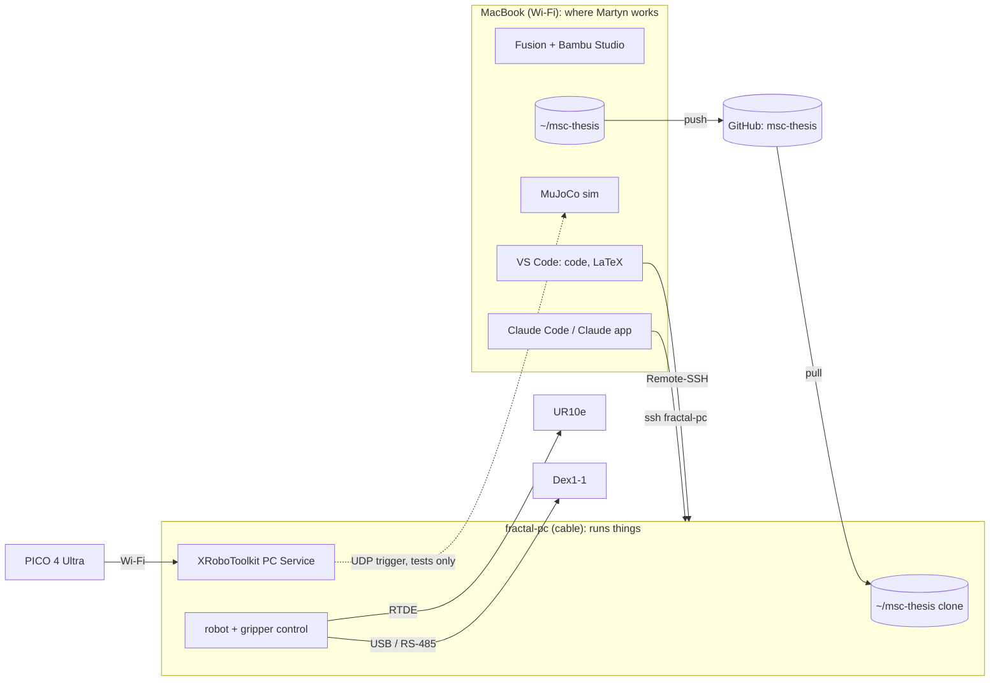

# Mac-centred lab workflow

How Martyn works on the MacBook only, with the lab Linux PC (`fractal-pc`), the PICO headset and the robot reached over the lab network. Agreed points from the thread "Plan the MacBook, lab PC, PICO and robot workflow" (2026-11-11). Nothing is installed or changed yet.

Facts from Martyn (2026-11-11): the lab (ARENA2036) network is separate from the company internal network. On it: MacBook (lab Wi-Fi), UR10e, `fractal-pc` (shared with other students, own user account, `ssh fractal-pc` lands in it), PICO 4 Ultra. `fractal-pc` reaches github.com. The Dex1-1 USB-to-RS-485 adapter plugs into the PC.

## Picture

## Rules

1. **Git is the single source.** Code is written in `~/msc-thesis` on the Mac and pushed to GitHub; the PC has its own clone and runs `git pull` before a run. Replaces the scp copy of `software/xr/trigger_udp.py` in `~/xr_trigger`, which can drift from the Mac original.
2. **PC access from the Mac only.** Terminal: `ssh fractal-pc`. Editor, terminal and file tree on the PC inside VS Code: [Remote-SSH](https://code.visualstudio.com/docs/remote/ssh). It installs a server in the home folder on the PC ([VS Code Server](https://code.visualstudio.com/docs/remote/vscode-server)), no sudo; it is still a new install on a shared PC, so it waits for Martyn's go.
3. **Claude stays on the Mac.** A Remote Control thread on the Mac runs `ssh fractal-pc …` in Martyn's shell (used for the survey and setup on 2026-11-09). This may make the Claude Code install in [[2026-11-09 Lab workstation Claude Code plan]] unnecessary. Yanmei's OK is still needed, since Claude would run commands on a company PC.
4. **Real-time work runs on the PC, not over Wi-Fi.** XRoboToolkit has no macOS support; RTDE on e-Series runs at up to 500 Hz ([UR RTDE guide](https://www.universal-robots.com/articles/ur/interface-communication/real-time-data-exchange-rtde-guide/)); the Dex1-1 is on the PC's USB. The Mac only watches, edits and runs the sim. Wi-Fi latency between PC and Mac: unmeasured.

| Where | What |
| --- | --- |
| Mac | Fusion, Bambu Studio, MuJoCo sim, LaTeX, vault, all code editing, Claude |
| PC | XRoboToolkit PC Service, UR10e control, Dex1-1 over RS-485, recording, later GPU training |

## Setup steps (proposed, not done)

1. GitHub access from the PC: an SSH key in Martyn's PC account. Either a read-only [deploy key](https://docs.github.com/en/authentication/connecting-to-github-with-ssh/managing-deploy-keys#deploy-keys) for `msc-thesis` (PC can only pull; all edits on the Mac) or a personal key (PC can push too). Choice open.
2. Clone `msc-thesis` to `~/msc-thesis` on the PC; point the trigger sender at the repo copy instead of `~/xr_trigger`.
3. Install the Remote-SSH extension on the Mac and connect to `fractal-pc` (after go).

## Open

- Deploy key or personal key (step 1).
- Where raw recordings (MCAP) are stored and how they reach the Mac or training; raw data stays out of Git.
- Yanmei's OK for Claude running commands on the PC.
- **Later topic (Martyn, 2026-11-11):** can a Raspberry Pi replace the PC for the Dex1-1 / RS-485 link? Not addressed here.
