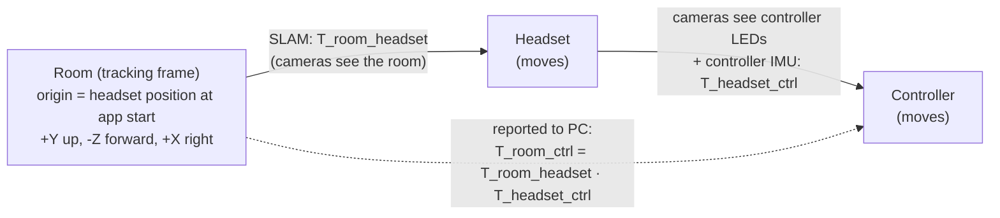
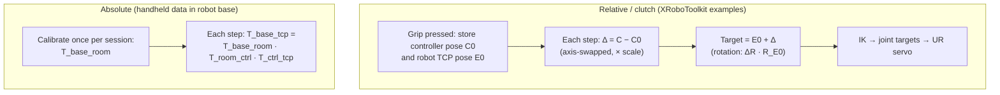

# Controller pose to robot frame

Question (Martyn, 2026-11-17): if the PICO controller is tracked relative to the headset, how does tracking work with the headset (1) worn, (2) hung around the neck, (3) on a fixed mount? And how is the controller pose turned into a command in the robot's coordinate system?

Method: source read of the XRoboToolkit headset app ([XRoboToolkit-Unity-Client @ cdc5316](https://github.com/XR-Robotics/XRoboToolkit-Unity-Client/tree/cdc53166b0bf412efae71046c6a225eb5091605f), including the bundled PICO Unity SDK 3.1.2), the Python SDK ([XRoboToolkit-PC-Service-Pybind @ 8941e1d](https://github.com/XR-Robotics/XRoboToolkit-PC-Service-Pybind/tree/8941e1dbbf4313fe83846f82984eaa8c992690bf)), the teleop examples ([XRoboToolkit-Teleop-Sample-Python @ 79e5cb8](https://github.com/XR-Robotics/XRoboToolkit-Teleop-Sample-Python/tree/79e5cb8a56e3455515ce1b476e993c764ec58739)), Unitree's XR teleop wrapper ([televuer @ 766de45](https://github.com/unitreerobotics/televuer/tree/766de45e74373ae0ea66321d942ce538385655a5)), the OpenXR specification source ([OpenXR-Docs @ 18ebc03](https://github.com/KhronosGroup/OpenXR-Docs/blob/18ebc0374da23c020ef4c949f9b144ffae6160ef/specification/sources/chapters/spaces.adoc)), and the bib papers zhao2025 (XRoboToolkit), chi2024 (UMI), zeng2025 (ActiveUMI), li2025 (ViTaMIn-B), surendran2026, cheng2026, liu2026, nai2026 (arXiv HTML). The PICO developer docs (developer.picoxr.com) were only navigation shells without content, so **no official PICO doc page was read**; PICO behaviour below comes from PICO's SDK code shipped inside XRoboToolkit. Nothing was tested on hardware.

## Short answer

1. **The controller pose is not reported relative to the headset.** XRoboToolkit reports it in a fixed "room" frame (the *tracking frame*) that the headset sets up once, when the app starts. The headset uses its cameras to know where *it* is in the room (inside-out SLAM, see below) and where the controller is, and it then subtracts its own motion. So the headset can move (on the head or on the neck) and a controller held still keeps the same coordinates.
2. **What changes between worn, neck-hung and fixed** is not the maths but (a) whether the controller stays in view of the headset cameras and (b) how well the headset can keep its own position in the room. That is a measurement question (already planned in [[D04 Pose tracking]]).
3. **Turning it into a robot command** needs one more link: the tracking frame → robot base. XRoboToolkit's teleop examples avoid measuring this link by using **relative (clutch) control**: only the controller's *change* since the grip button was pressed is used, after a fixed axis swap. For **handheld data stored as absolute end-effector poses**, as the current export convention says, the tracking-frame → robot-base link must be measured (calibration), and redone whenever the tracking frame is re-made.

## 1. Terms

- **Frame**: a reference point plus three axes (x, y, z). A pose (position + orientation) only means something together with the frame it is given in.
- **Transform** `T_A_B`: the pose of frame B written in frame A (a 4×4 matrix: rotation + translation). Transforms chain: `T_A_C = T_A_B · T_B_C`.
- **Inside-out SLAM** (Simultaneous Localisation And Mapping): the headset's own cameras look at the room, build a small map of it, and work out where the headset is in that map. No base stations. The PICO 4 Ultra has 4 tracking cameras for this (see [[2026-11-17 PICO control from the Mac and neck-hung headset]]).
- **Tracking frame** (OpenXR calls it the *LOCAL* space): the room-fixed frame all poses are reported in.
- **Recenter**: re-defining the tracking frame at the headset's current place and heading (on PICO: hold the Home button; PICO SDK has a `RecenterSuccess` callback, [PXR_Manager.cs L346–354](https://github.com/XR-Robotics/XRoboToolkit-Unity-Client/blob/cdc53166b0bf412efae71046c6a225eb5091605f/PICO%20Unity%20Integration%20SDK/Runtime/Scripts/PXR_Manager.cs#L346-L354)).
- **Clutch / relative control**: the robot moves only while a button is held, by the amount the hand moved since the press. Releasing the button lets the hand move without moving the robot.
- **Absolute control**: the robot goes to the pose that the hand has, written in robot coordinates. Needs the tracking-frame → robot-base transform.

## 2. Which frame the controller pose is in



The headset measures the controller relative to itself (cameras on the headset see the controller's LEDs), but it immediately multiplies by its own room pose, so what leaves the headset is `T_room_ctrl`. Evidence:

| Claim | Source |
| --- | --- |
| XRoboToolkit data are in a "right-handed coordinate system with X-axis right, Y-axis up, and Z-axis backward"; "the origin is established at the user's head position when the application launches" | zhao2025, Sec. II-B |
| OpenXR's LOCAL space "establishes a world-locked origin, gravity-aligned to exclude pitch and roll, with +Y up, +X to the right, and -Z forward"; it locks in "the initial position at application launch or some other calibrated zero position" | [OpenXR spec, spaces.adoc L189–198](https://github.com/KhronosGroup/OpenXR-Docs/blob/18ebc0374da23c020ef4c949f9b144ffae6160ef/specification/sources/chapters/spaces.adoc#L189-L198) |
| The headset app reads the controller with `PXR_Input.GetControllerPredictPosition/Rotation`, which return the PICO field `localControllerPose` (PICO also has a `globalControllerPose`; meaning of "local" vs "global" not documented in the code) | [TrackingData.cs L313–338](https://github.com/XR-Robotics/XRoboToolkit-Unity-Client/blob/cdc53166b0bf412efae71046c6a225eb5091605f/Assets/Scripts/TrackingData.cs#L313-L338), [PXR_Input.cs L265–276](https://github.com/XR-Robotics/XRoboToolkit-Unity-Client/blob/cdc53166b0bf412efae71046c6a225eb5091605f/PICO%20Unity%20Integration%20SDK/Runtime/Scripts/Features/PXR_Input.cs#L265-L276), [PXR_Plugin.cs L1699–1703](https://github.com/XR-Robotics/XRoboToolkit-Unity-Client/blob/cdc53166b0bf412efae71046c6a225eb5091605f/PICO%20Unity%20Integration%20SDK/Runtime/Scripts/PXR_Plugin.cs#L1699-L1703) |
| The app's XR rig uses tracking origin mode `1` = Device (eye level, not floor) | [XR Origin prefab L5806](https://github.com/XR-Robotics/XRoboToolkit-Unity-Client/blob/cdc53166b0bf412efae71046c6a225eb5091605f/Assets/InteractionTools/Prefabs/XR%20Origin%20(XR%20Rig).prefab#L5806) (mapping 1 = Device from Unity's XR Origin enum, unverified against Unity docs) |
| The Python SDK passes the 7 numbers `x, y, z, qx, qy, qz, qw` through unchanged | [py_bindings.cpp L76–145](https://github.com/XR-Robotics/XRoboToolkit-PC-Service-Pybind/blob/8941e1dbbf4313fe83846f82984eaa8c992690bf/bindings/py_bindings.cpp#L76-L145) |
| The teleop examples convert the controller pose with one **constant** rotation; if the pose were headset-relative, a constant rotation could not work while the head turns | [geometry.py L4–10](https://github.com/XR-Robotics/XRoboToolkit-Teleop-Sample-Python/blob/79e5cb8a56e3455515ce1b476e993c764ec58739/xrobotoolkit_teleop/utils/geometry.py#L4-L10) |

Conclusion: room frame, origin at the headset's place at app start (or last recenter), Y up, levelled to gravity (OpenXR rule; PICO's native SDK assumed to follow it, unverified). Units metres.

## 3. Worn, neck-hung, fixed mount

The coordinates stay in the same room frame in all three. What differs:

| | Worn on head | Hung on neck | Fixed mount (tripod) |
| --- | --- | --- | --- |
| Where the frame origin is | Head at app start | Chest/neck at app start | Mount position |
| Headset sees the controller | Where the operator looks; the head follows the hands naturally | Only in front of the chest, cameras tilted down; hands above shoulder or to the side likely leave view | Only inside a fixed cone; operator's body can block the view (occlusion) |
| Headset keeps its own room pose (SLAM) | Normal use case | Sees mostly torso and floor; fewer room features | Static; easy, but PICO may sleep when still (`persist.pvr.sleep_by_static=1`, unverified) |
| Proximity sleep | No issue | Tape over sensor (tested) | Tape over sensor needed |
| Precedent | zhao2025, zeng2025 (worn HMD) | zhao2025 Sec. III-A: "the XR headset can be worn around the neck when stereoscopic visual feedback is not required" (one sentence, no measurement) | None found in the sources read |
| Measured here | Not yet | 120 s continuity test, 2026-11-17 (0.4 % stalls, one 0.077 m step) | Not tested |

**When the controller leaves camera view**: the OpenXR rule is that the runtime "should continue to provide inferred or last-known position", e.g. by "inertial dead reckoning" (IMU only), and only flags it as not tracked ([spaces.adoc L211–222](https://github.com/KhronosGroup/OpenXR-Docs/blob/18ebc0374da23c020ef4c949f9b144ffae6160ef/specification/sources/chapters/spaces.adoc#L211-L222)). So the pose does **not** go to zero: it drifts, then snaps back when the LEDs are seen again. XRoboToolkit sends **no tracked/not-tracked flag for the controllers** (only the headset has a `status` field; [TrackingData.cs L340–392](https://github.com/XR-Robotics/XRoboToolkit-Unity-Client/blob/cdc53166b0bf412efae71046c6a225eb5091605f/Assets/Scripts/TrackingData.cs#L340-L392)), so a recorder cannot see such gaps directly. A jump like today's 0.077 m step may be one (unknown).

**Drift and re-anchoring**: the room frame is only as stable as the headset's SLAM. Small map corrections can shift all poses; a recenter or app restart moves the origin completely. Accuracy of inside-out headset tracking against motion capture or a robot is measured in banaszczyk2024 and hu2024 (numbers not re-checked for this note; PICO 4 Ultra not covered, unverified).

**Predicted, not measured**: the app asks for the controller pose *predicted* to the next display time (`GetPredictedDisplayTime`, [TrackingData.cs L62–64](https://github.com/XR-Robotics/XRoboToolkit-Unity-Client/blob/cdc53166b0bf412efae71046c6a225eb5091605f/Assets/Scripts/TrackingData.cs#L62-L64)), so each pose is extrapolated slightly ahead. Effect on accuracy: unverified.

## 4. From controller pose to robot command

The full chain to the gripper tip (TCP = tool centre point) in robot base coordinates:

```
T_base_tcp  =  T_base_room  ·  T_room_ctrl  ·  T_ctrl_tcp
               (calibration)   (streamed,       (fixed by the handheld
                re-do after     90 Hz)           CAD / measured once)
                recenter)
```

- **Axis swap** (no measurement needed): XR uses Y up, −Z forward; the robot uses Z up, X forward. XRoboToolkit and Unitree use the same matrix: robot x = −XR z, robot y = −XR x, robot z = XR y ([geometry.py L4–10](https://github.com/XR-Robotics/XRoboToolkit-Teleop-Sample-Python/blob/79e5cb8a56e3455515ce1b476e993c764ec58739/xrobotoolkit_teleop/utils/geometry.py#L4-L10); `T_ROBOT_OPENXR` in [tv_wrapper.py L137–140](https://github.com/unitreerobotics/televuer/blob/766de45e74373ae0ea66321d942ce538385655a5/src/televuer/tv_wrapper.py#L137-L140)). This only fixes the *directions*; it assumes the operator faced the robot's +x direction at app start (otherwise "forward" is rotated about the vertical).
- **Where the room origin sits relative to the robot base** (`T_base_room`): needs a calibration (see options below).
- **Controller → TCP** (`T_ctrl_tcp`): fixed by the handheld design; from CAD, or solved in the same calibration (ViTaMIn-B does this).

### Two ways to use the chain



**Relative / clutch** ([dual_arm_ur_controller.py L170–262](https://github.com/XR-Robotics/XRoboToolkit-Teleop-Sample-Python/blob/79e5cb8a56e3455515ce1b476e993c764ec58739/xrobotoolkit_teleop/hardware/dual_arm_ur_controller.py#L170-L262), zhao2025 Sec. II-C.1):
- Holding the grip button (> 0.9) activates; at the press, the controller pose and the robot's current TCP pose are stored.
- Position: `target = E0 + scale · R_axis · (C − C0)`; scale 0.8 for the UR example ([L42](https://github.com/XR-Robotics/XRoboToolkit-Teleop-Sample-Python/blob/79e5cb8a56e3455515ce1b476e993c764ec58739/xrobotoolkit_teleop/hardware/dual_arm_ur_controller.py#L42)), 1.0 in others.
- Orientation: the controller's rotation since the press, applied to the start orientation of the TCP ([geometry.py `apply_delta_pose`](https://github.com/XR-Robotics/XRoboToolkit-Teleop-Sample-Python/blob/79e5cb8a56e3455515ce1b476e993c764ec58739/xrobotoolkit_teleop/utils/geometry.py#L76-L126)); orientation is not scaled.
- Then inverse kinematics (IK: from TCP pose to joint angles, PlaCo QP solver) and joint servo commands to the UR.
- Why it suits teleop: the room origin's position never enters (it cancels in `C − C0`), so neither recentering nor the headset's placement matters, only the heading. Releasing the grip lets the operator re-grip comfortably ("clutch").

**Absolute** (Unitree televuer, ActiveUMI): the pose itself is mapped. Unitree, for a humanoid, makes the arm pose relative to the operator's head position or head yaw, then shifts it to the robot's waist by a fixed offset (+0.15 m x, +0.45 m z) ([tv_wrapper.py L89–119](https://github.com/unitreerobotics/televuer/blob/766de45e74373ae0ea66321d942ce538385655a5/src/televuer/tv_wrapper.py#L89-L119)). That uses the *head* as the reference, which suits a humanoid with a head, not a UR10e. ActiveUMI records "absolute coordinates relative to a unified world coordinate system that is established during an initial calibration phase", using a docking jig and a button press to reset the base frame (zeng2025, Sec. 3.3).

### How the handheld (UMI-style) papers handle the room → robot link

| Work | Tracker | Room → robot link | Action representation |
| --- | --- | --- | --- |
| UMI, chi2024 | GoPro SLAM | Not needed for the main policy: actions are "relative to gripper's current EE pose"; an absolute-action baseline that calibrated SLAM and robot to the same fiducial markers did worse, blamed on "inaccurate calibration" (Sec. V-A) | Relative trajectory |
| ViTaMIn-B, li2025 | Quest 3 controllers | Controller mounted on the arm, 10 poses recorded, solved `T_world_ctrl · T_ctrl_EE = T_world_base · T_base_EE` for `T_ctrl_EE` (Sec. IV-D); Quest's left-handed frames converted to right-handed | Relative EE (pose change from previous step) |
| ActiveUMI, zeng2025 | Quest headset + controllers | Docking jig + button press at session start (Sec. 3.3); world → robot base not stated | Absolute in that world frame (policy action form not stated) |
| DM-UMI, surendran2026 | XVISIO SLAM camera | Not stated | "relative end-effector and absolute gripper width" |
| TacUMI cheng2026, RDT2 liu2026 | Vive Tracker 3.0 | Fixed tracker → TCP transform (cheng2026); tracker → robot base not stated in the parts read | — |

Pattern: the handheld papers either use relative actions (and so skip the room → robot calibration) or calibrate once per session with a fixture.

## 5. What this means for the thesis set-up

- **VR teleop on the UR10e** (XRoboToolkit-style clutch): works with worn, neck-hung or fixed headset as long as the controller stays in camera view; the operator must face the robot's +x direction at app start or after recentering, or the axis swap needs an extra yaw angle.
- **Handheld recordings**: the convention in `msc-thesis/CLAUDE.md` is an absolute end-effector pose export. Absolute poses in the robot base need `T_base_room` per session (the room frame is re-made on every app start/recenter), e.g. by touching the handheld to known points on the robot or docking it on the flange (li2025, zeng2025 approaches). The alternative, used by UMI (chi2024) and ViTaMIn-B (li2025), is to train on relative actions, which needs no `T_base_room`. Which one fits GR00T / π0.5 is a separate question; nothing here changes the convention.
- **Neck-hung vs worn** stays an open measurement (D04): dropout, jumps and accuracy against the UR10e in both placements.

## Open
- PICO official docs on tracking origin, recenter and controller IMU fallback: not read (pages empty outside a browser). The meaning of PICO's `localControllerPose` vs `globalControllerPose` is inferred, not documented.
- Whether PICO 4 Ultra keeps the room frame across app restarts (persistent map) or re-anchors each time: unverified; matters for how often `T_base_room` must be calibrated.
- Fixed-mount headset: no precedent found, not tested; static-sleep property unverified.
- Controller out of view: drift and snap-back behaviour on PICO unmeasured; XRoboToolkit stream carries no controller tracking flag.
- A wider web search (PICO forums, other teleop stacks such as GR00T-WholeBodyControl) was not run; ask before running a deep-research pass if needed.
