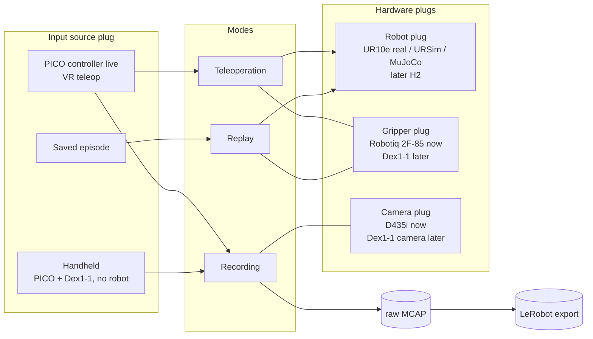
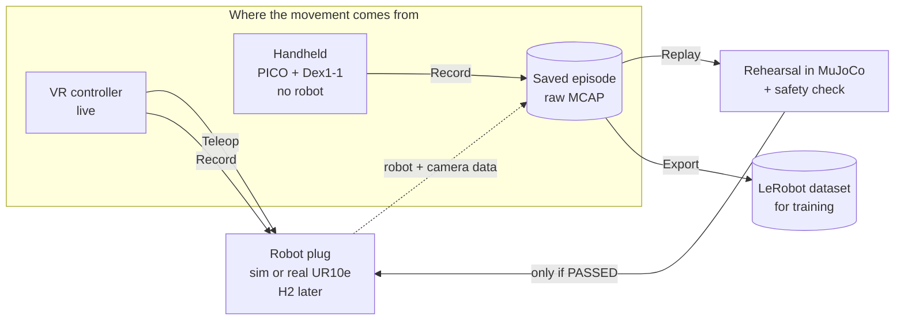

# SwapKit: one framework, three modes, swappable hardware

**SwapKit** is the working name for the framework Martyn asked about on 2026-11-24: one program with three modes (Teleoperation, Recording, Replay), where the robot, gripper, camera and input device are swappable parts. Built and proven on the UR10e first; the Unitree H2 later.

## Short answer

- **Feasible: yes.** About half of it already runs (replay in simulation and on the real UR10e, the team's VR teleop). Every piece has a published precedent (table below).
- **Thesis strength: yes, as the means, not as the headline.** It guarantees that handheld and VR data go through the same recorder, the same export and the same replay, which is what the fairness rules in the thesis plan (section 3) demand. "A modular robot framework" on its own is not new: RoboManipBaselines, XRoboToolkit, RAPID and LeRobot already claim it.
- **Main risk: time, not technique.** The mid-January gate (replay with the Dex1-1 succeeds) does not move. SwapKit must be built as part of the Replay Ladder, not next to it.

## Terms used here

| Term | Meaning |
| --- | --- |
| Mode | What the program does: drive the robot live (Teleoperation), save an episode (Recording), play a saved episode back (Replay) |
| Plug | A small program for one device that "speaks" a fixed set of commands, e.g. a gripper plug knows "set width", "set force limit", "read width". Swapping hardware = choosing a different plug in a settings file |
| Interface | The fixed list of commands every plug of one kind must offer. The modes only talk to the interface, never to a device directly |
| Episode | One recorded demonstration, start to stop |

## The picture

Read it as: pick an input, pick a mode, pick the plugs in a settings file. The recorder and the export are the same for every combination.

What each mode needs:

| Mode | Input | Robot | Gripper | Camera | Writes |
| --- | --- | --- | --- | --- | --- |
| Teleoperation | VR controller live | real or simulated | set width | optional (operator view) | nothing |
| Recording, VR | VR controller live | real or simulated | set + read width | read images | raw MCAP |
| Recording, handheld | handheld | none | read width (Dex1-1 on the handheld) | read images | raw MCAP |
| Replay | saved episode | real or simulated | set width | optional (check) | log of what the robot did |

Note: with the real Dex1-1 on the handheld (D01 (handheld gripper body)), the **same gripper plug** reads the width on the handheld and sets it on the robot. That is a concrete benefit of the plug design for this thesis.

## What already exists (2026-11-24)

| Piece | Status | Where |
| --- | --- | --- |
| Replay in MuJoCo (RL1) | runs | dex1-1-handheld `software/sim/ur10e_replay.py` |
| Replay to URSim and real UR10e (RL2, RL3) | runs, passed 2026-11-23 | `software/sim/ur10e_replay_rtde.py` |
| VR teleop of the UR10e | runs, team stack | team fork of `xr_teleoperate` (pinned 7e6c754, not ours) |
| UR10e IK, HOME_Q, speed limit | reused from team stack, not copied | same |
| Pose / trigger logging | runs (CSV) | `software/xr/pose_log.py`, `trigger_log.py` |
| H2 and UR10e models for MuJoCo | load and run; H2 cannot stand yet (needs balance controller) | `software/sim/load_models.py` |
| Gripper plug design | agreed, not built | vault `Agent/Reports/2026-11-24 Open items clean-up.md` |
| Recorder (raw MCAP) and LeRobot export | decided (D07 (data format)), not built | RL5 (camera + recorder test) |

So today the pieces are separate scripts. SwapKit mainly means: put them behind fixed interfaces instead of writing a new script per robot.

## How prior work splits it

| Framework | Split into | Modes | Robots shown | Fit for this thesis | Bib |
| --- | --- | --- | --- | --- | --- |
| [RoboManipBaselines](https://arxiv.org/html/2509.17057v2) | environment (robot + sensors), dataset, policy; one Gym-style interface for real and sim | teleop + collection, train, rollout; no replay mode | sim: UR5e, xArm 7, Franka, Kinova, ALOHA, Unitree G1 and more (MuJoCo); real: UR5e, xArm 7 | Closest precedent for "same code in sim and real". New robot = inherit one class, override a few methods (sec. IV-A). Input: keyboard, 3D mouse, GELLO; no VR, no handheld | murooka2026 |
| [XRoboToolkit](https://arxiv.org/html/2508.00097) | XR app on headset, PC service, Python SDK, robot-side IK | teleop, recording on the headset; no replay | real: UR5 (dual), ARX R5, Galaxea R1-Lite; sim: MuJoCo only | Already the input layer here (PICO). Robot side has no plug system (sec. II-A) | zhao2025 |
| [RAPID](https://rapid-kit.github.io/) | modular hardware + software that knows which sensors are plugged in | handheld collection and robot deployment in one system | not read (abstract only) | Closest to "plug and play gripper and camera" and to handheld + robot in one stack. Measures modularity as setup time (two orders of magnitude faster, abstract) | yin2026 |
| [UMI](https://umi-gripper.github.io) | handheld collection, policy interface | collect, train, deploy | several arms | Its recorded data is robot-independent (end-effector pose + gripper width), "deployable across multiple robot platforms" (abstract). Same action format as here (D07) | chi2024 |
| DM-UMI | one device used both as handheld and as teleop input | handheld and teleop collection | one arm | Only precedent found for handheld + teleop data from one system; also shows naive mixing can hurt (vault `Literature/@surendran2026`) | surendran2026 |
| [LeRobot](https://huggingface.co/docs/lerobot/il_robots) | `Robot`, `Teleoperator`, camera classes; settings class per device | `lerobot-teleoperate`, `lerobot-record`, `lerobot-replay` (sends recorded actions back to the robot) | many low-cost arms | Same three modes as Martyn's list, as ready commands. Handheld (no robot) is not a built-in case (unverified) | not in bib |
| [Unitree xr_teleoperate](https://github.com/unitreerobotics/xr_teleoperate) | arm IK, hand/gripper control, image service, recorder | teleop, `--record`, `--sim` (Isaac Lab); no replay command | G1, H1, H1_2, **H2** (since v1.6, 2026-07-29), R1; end-effectors include **Dex1-1** (`--ee dex1`) | The team fork adds the UR10e and holds `assets/h2/H2.urdf`, so the team stack already switches robots by a setting. Whether pin 7e6c754 includes upstream H2 control: unverified | not in bib |

What the precedents agree on:
1. One fixed interface per device kind; a new device = one small class + a settings file (RoboManipBaselines, LeRobot).
2. Real and simulated robots behind the same interface (RoboManipBaselines).
3. Robot-independent episode format: end-effector pose + gripper width (UMI, already D07).
4. No precedent found for one framework that does VR teleop, handheld recording and replay, across sim and real, with swappable grippers. DM-UMI and RAPID come closest. This was checked only against the bib and the sources above, not with a wide search.

## Options

| | Option | What it means | Source | Thesis impact | Time |
| --- | --- | --- | --- | --- | --- |
| A | **Thin SwapKit inside the Replay Ladder** (recommended) | Own small interfaces (robot, gripper, camera, input) in dex1-1-handheld. Existing scripts move behind them during RL4–RL5. Team stack stays the UR10e and H2 driver (outside dependency). Built plugs: UR10e (MuJoCo, URSim, real), Robotiq, D435i; later Dex1-1. H2 plug only as stretch | RoboManipBaselines pattern; UMI data format | Methods chapter gets one "system" section; no new research question; fairness rules get a concrete guarantee | Mostly inside RL4–RL6; extra effort unverified, estimated days, not weeks |
| B | **Build on LeRobot** | Write UR10e, Robotiq, PICO as LeRobot `Robot` / `Teleoperator` plugins; use its record and replay commands | LeRobot docs | Same as A; less own code, but a new dependency (needs Martyn's OK), and handheld recording without a robot must be fitted in | Learning cost; unverified whether its loop fits the 125 Hz RTDE and the MCAP raw format of D07 |
| C | **SwapKit as a second contribution** | A + a measured portability test: same episode replayed on two grippers (Robotiq and Dex1-1) and, if time, on the H2; count code and time to add each plug (RAPID measures setup time) | RAPID, RoboManipBaselines | Adds a small result chapter section; needs the plan's scope table changed | +about 1 week in March (buffer month), unverified |
| D | **H2 in the core** | Prove modularity on the H2 before submission as a must | xr_teleoperate H2 support | Moves H2 from stretch to core; H2 needs standing balance control, not set up | High; collides with the mid-January gate and data collection in January |

Why A first: it costs least, fixes the interfaces before the Dex1-1 arrives (RL6 (swap to the Dex1-1) becomes the first real plug swap, at no extra lab time), and keeps C open for March. D is not recommended: the plan's rule "if replay does not succeed by mid-January, all stretch goals are dropped" would still apply, and the H2 balance controller is unsolved.

## What changes in the thesis (proposal, needs Martyn's OK)

- **Research question:** unchanged. SwapKit is the tool that answers it fairly.
- **Contributions:** add "a single recording, export and replay pipeline for handheld and VR data, with swappable robot, gripper and camera" next to the error budget (plan section 4).
- **Scope table (plan section 2):** core keeps UR10e only. Option C would add "portability check: one episode on two grippers" to core or stretch.
- **Schedule (plan section 5):** no new phase. RL4 (Robotiq pick-and-place) builds the gripper plug, RL5 (camera + recorder) builds the camera plug and recorder, RL6 (swap to the Dex1-1) is the first swap test. VR teleop in MuJoCo for the UR10e is a new small piece (live version of RL1).
- **Thesis plan and CLAUDE.md:** not changed by this note. Changing them is Martyn's call.

## Check of Martyn's picture (2026-11-25)

Martyn wrote out his understanding on 2026-11-25. Mostly right; five corrections, then the simulation choice.

| Martyn's point | Verdict | Correction or detail |
| --- | --- | --- |
| VR teleop can drive the robot only (Teleop) or also save the episode (Record) | right | In Record the robot's own movement, gripper width and robot camera are saved |
| A recorded episode can only be replayed | right, add one | It can also be exported to LeRobot for training. And the episodes replayed so far are **handheld** recordings (RL1–RL4 (replay in MuJoCo, URSim, real UR10e, Robotiq open/close)): replay is how handheld data is checked on the robot, which the mid-January gate needs |
| Replay works on the robot, simulated or real | right, with an order | Replay on the real robot always plays the episode in MuJoCo first, then runs the safety check (allowed box, floor clearance), and only then moves the real UR10e (`ur10e_replay_rtde.py` uses the MuJoCo replay's joint targets; RL4 setup file). So "real" means "sim rehearsal, then real" |
| Handheld records without a robot | right | Gripper on the handheld = Dex1-1 (it reads its own width); camera = the Dex1-1 camera, because the only D435i sits on the robot flange. There is no simulated handheld: it is a real device |
| Recording on the Dex1-1 because the Robotiq is heavy | partly | Weight matters only for the **handheld**. For VR recording on the UR10e the gripper sits on the robot, so the Robotiq works. But for the thesis data all conditions must use the same gripper and camera (thesis plan §3 fairness rules), so final data = Dex1-1 on robot and handheld; Robotiq data stays pilot data |
| Camera not relevant in teleop only | mostly | Nothing is saved, so no camera plug is needed. Optional: the team's VR teleop can stream a robot camera into the headset (`xr_teleoperate` image service, [README](https://github.com/unitreerobotics/xr_teleoperate)); at the UR10e table the operator sees the robot directly |
| Any robot × any gripper × any camera | not every pair | The H2 carries the Dex1-1 (Unitree's own gripper); Robotiq on the H2 is not planned. Sim side today: UR10e + Robotiq in MuJoCo exist; a simulated camera plug does not exist yet |
| Hardware plugs come as real or simulated | right | Same interface, e.g. `robotiq_2f85` (real) and `sim_robotiq_2f85` (MuJoCo), both behind the one gripper program (`software/gripper/gripper_program.py`, RL4 2026-11-25) |

### Simulation: one environment, MuJoCo (recommendation)

| | MuJoCo | Isaac Lab / Isaac Sim |
| --- | --- | --- |
| Runs on the Mac | yes, RL1 and RL4 simulations run there today | no: Linux or Windows only, NVIDIA RTX GPU; NVIDIA lists RTX 4080 / 16 GB as minimum ([requirements](https://docs.isaacsim.omniverse.nvidia.com/latest/installation/requirements.html), read from a summary, unverified). fractal-pc has a 12 GB RTX 3080 Ti; Unitree reports tests on an RTX 3080 ([unitree_sim_isaaclab](https://github.com/unitreerobotics/unitree_sim_isaaclab)) |
| Models in use | UR10e and Robotiq 2F-85 (MuJoCo Menagerie, BSD-3), own Dex1-1 model (`software/sim/dex1_1_mujoco.py`), H2 model loads (unitree_mujoco, cannot stand yet) | Unitree's sim: G1 and H1-2 with Dex1, Dex3, Inspire; **no H2** and no UR10e in its README |
| Prior work | RoboManipBaselines (murooka2026) robots mostly in MuJoCo; XRoboToolkit (zhao2025) "currently supports only MuJoCo" | Unitree's teleop data collection (`xr_teleoperate --sim`) |
| Cost to switch | none | new install on a shared Linux PC, new models for UR10e and Robotiq |

Recommendation: **MuJoCo only.** Everything the core thesis needs (UR10e, Robotiq, Dex1-1) already runs there, on the Mac where Martyn has a display. Isaac Lab would only pay off for Unitree's ready-made G1 / H1-2 scenes, and it does not list the H2. Revisit if the H2 stretch goal starts and Unitree publishes an H2 Isaac scene before a standing H2 runs in MuJoCo.

## Open / unverified

- Whether team pin 7e6c754 contains upstream H2 arm control (check on the Mac: `git log` of `~/thesis/team/xr_teleoperate`, read-only).
- How the H2 arms are driven while the robot stands (balance controller); H2 MuJoCo model loads but cannot stand.
- LeRobot fit (option B): its camera class and simulation interface were not read.
- Effort estimates in the options table are guesses, not measured.

## Decision

2026-11-24: Martyn chose option A (thin SwapKit inside the Replay Ladder; H2 stays stretch). Recorded in [[D07 Software and data format]] (History 2026-11-24); roadmap: [[2026-11-24 Red Line roadmap]].
